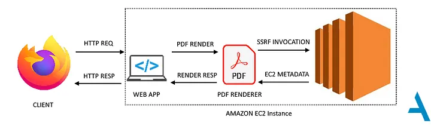

# SSRF via HTML Injection in Server-Side PDF Generation



---

## 1. Overview

A Stored HTML Injection vulnerability was escalated to Server-Side Request Forgery (SSRF) in a web application hosted on AWS EC2.

The application generated HTML reports using user-provided registration data and converted those reports into PDF files on the server. Because user input was not properly handled in the HTML output, an attacker could inject an HTML element that caused the PDF generator to make server-side network requests.

The SSRF was then exploited to access the AWS EC2 Instance Metadata Service and retrieve temporary credentials associated with the instance's IAM role.

## 2. Root Cause

The application used user-controlled data, specifically the user's address, inside an HTML report without appropriate context-specific output encoding.

The same data was processed by both:

- The HTML report preview.
- The server-side HTML-to-PDF conversion process.

This allowed injected HTML to be interpreted as markup rather than displayed as plain text.

**Key issue:** User-controlled HTML was processed by a server-side component capable of making network requests.

## 3. Vulnerability Discovery

### Step 1: Identify HTML Injection

During registration, the tester supplied the following value as the user's address:

```html
<iframe src="https://appsecco.com"></iframe>
```

The HTML preview rendered the injected iframe instead of displaying the input as plain text.

The iframe also appeared in the generated PDF, indicating that the PDF generation process used the HTML report as its input.

### Step 2: Confirm Server-Side Requests

The tester used Burp Suite Collaborator to distinguish between a browser-generated request and a request originating from the application server.

A new user was registered with an iframe pointing to a controlled Collaborator URL:

```html
<iframe src="http://BURP-COLLABORATOR-URL"></iframe>
```

After triggering PDF generation, the Collaborator listener received DNS and HTTP interactions originating from the web application's server.

This confirmed that the server-side PDF generation process was making network requests based on attacker-controlled HTML.

**Finding:** SSRF via HTML Injection during server-side PDF generation.

## 4. Exploitation: AWS EC2 Instance Metadata

### Step 1: Access the Metadata Service

The tester investigated whether the SSRF could reach the AWS EC2 Instance Metadata Service (IMDS), which is available from within an EC2 instance at:

```text
http://169.254.169.254/
```

The following metadata path was used to identify the IAM role associated with the instance:

```text
/latest/meta-data/iam/security-credentials/
```

The injected iframe caused the PDF generator to request this resource, and the resulting information revealed the attached IAM role.

### Step 2: Retrieve Temporary Credentials

Using the discovered role name, the tester requested the corresponding role credentials through the metadata endpoint:

```text
/latest/meta-data/iam/security-credentials/ROLE-NAME-HERE
```

The temporary AWS credentials were rendered in the generated PDF and could be retrieved by the tester.

This was possible because the EC2 instance had an IAM role attached and the vulnerable server-side request mechanism could reach the metadata service.

### Step 3: Identify the Credentials and Permissions

The tester configured the AWS CLI to use the retrieved credentials through a dedicated profile.

The following command was used to identify the AWS identity associated with the credentials:

```bash
aws sts get-caller-identity --profile ssrftoken
```

The tester then used the `enumerate-iam` tool to assess the permissions associated with the compromised IAM identity.

Testing stopped after permission enumeration, and the vulnerability was reported to the client.

**Important:** The actual impact depends on the permissions granted to the IAM role. Access to temporary credentials does not automatically mean full compromise of the AWS account.

## 5. Impact

The vulnerability chain demonstrated the following potential consequences:

- **Internal Network Access:** The server could be induced to make requests to destinations selected through injected HTML.
- **Metadata Exposure:** The SSRF allowed access to EC2 instance metadata.
- **Credential Exposure:** Temporary AWS credentials associated with the instance's IAM role were retrieved.
- **Cloud Resource Access:** The exposed credentials could potentially access AWS resources according to the IAM role's permissions.

The overall severity depends on the accessible network destinations, the exposed credentials, and the privileges assigned to the IAM role.

## 6. Mitigation

### Input Handling and Output Encoding

- Apply context-specific output encoding wherever user-provided data is inserted into HTML.
- Treat user input as data, not trusted HTML.
- If HTML input is genuinely required, use a well-maintained HTML sanitizer with a restrictive allowlist.

### SSRF Prevention

- Validate and restrict URLs and destinations used by server-side components.
- Apply outbound network controls to prevent access to internal services and cloud metadata endpoints where possible.
- Avoid allowing untrusted HTML to trigger arbitrary network requests during PDF generation.

### AWS Metadata Protection

- Prefer IMDSv2 over IMDSv1 to add protection against common SSRF techniques.
- Restrict metadata access where supported and appropriate for the workload.
- Follow least privilege when assigning IAM roles to EC2 instances.
- Avoid granting permissions that are unnecessary for the application's operation.

IMDSv2 is a defense-in-depth measure, not a replacement for fixing the underlying SSRF vulnerability.

---

## 8. References

- Original writeup: [Read](https://medium.com/appsecco/finding-ssrf-via-html-injection-inside-a-pdf-file-on-aws-ec2-214cc5ec5d90)
- AWS EC2 Instance Metadata Service (IMDS) documentation: https://docs.aws.amazon.com/AWSEC2/latest/UserGuide/ec2-instance-metadata.html
- `enumerate-iam`: https://github.com/andresriancho/enumerate-iam
